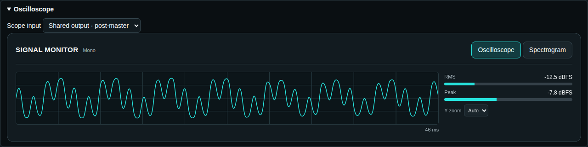
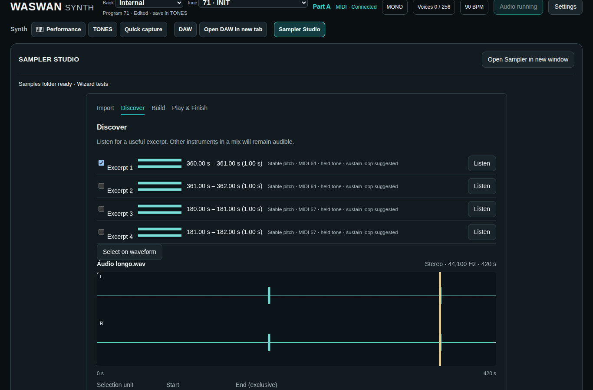
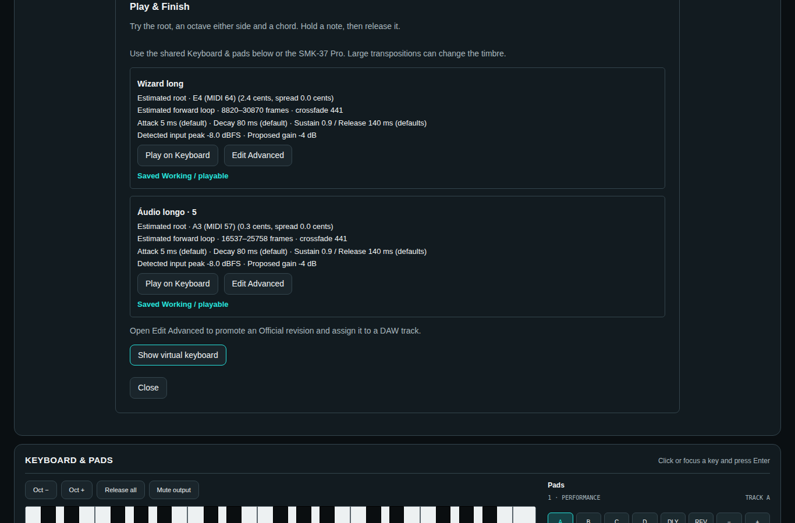

# WASWAN Auto Instrument Wizard

Em **Sampler Studio → Auto Instrument Wizard**, escolha uma gravação, ouça os trechos sugeridos e toque um deles antes de salvar. Cada seleção gera um instrumento independente na mesma biblioteca do editor avançado.

O painel **Oscilloscope**, acima das quatro etapas, permite acompanhar a prévia isolada de **Listen** ou a saída compartilhada do instrumento. Em **Play & Finish**, **Keyboard FX** começa em **Dry**. Escolha **Use Synth FX** para ouvir os envios da Parte A e o processamento de master ao tocar. A escolha também pode mudar durante a sustentação. **Release Keyboard** recupera o modo do sampler que estava armado antes do Wizard.



## Do WAV ao teclado

1. **Import.** Escolha ou autorize a pasta Samples e use **Choose WAV…**. O original aceita RIFF PCM16 mono ou estéreo a 44,1 ou 48 kHz. Confira o nome e a duração na waveform. **What are you looking for?** orienta a busca. Para uma voz em uma vogal longa, use **Sustained tone / voice**.
2. **Discover.** Ouça os cartões com **Listen**. Marque os que deseja levar adiante. Para outro trecho, use **Select on waveform**, arraste ou digite os limites e clique em **Use waveform selection**. Desmarque uma sugestão para substituí-la. Uma mixagem conserva o acompanhamento que estiver naquele intervalo.
3. **Build.** Confira nome, caráter, raiz e sustain por recorte. Para uma nota cromática incerta, escolha a raiz. Para uma textura ou percussão, **Unpitched trigger (C4)** reproduz o trecho na tecla MIDI 60 à velocidade original. **Sustain On** pede uma busca de loop inclusive para sons dedilhados. A ausência de uma emenda confiável resulta em one-shot e permite tentar outro trecho.
4. **Play & Finish.** Com o áudio iniciado, **Play on Keyboard** arma o instrumento específico na Parte A. **Show virtual keyboard** leva ao teclado existente. Teste também no SMK-37 Pro. **Release Keyboard** devolve a rota anterior. **Finish** grava o derivado e a Working Copy de cada seleção. **Edit Advanced** abre essa cópia no Mapping Editor e, se necessário, oferece salvá-la antes de abrir. **Promote to Official** e a atribuição da revisão a uma pista ficam no Studio.





## Como interpretar a proposta

O Worker percorre janelas de um segundo a cada meio segundo. Considera energia, transientes, periodicidade e decaimento, elimina sobreposições fortes e oferece até cinco intervalos. Um trecho manual pode ter de 60 ms a 16 s. Pitch numérico, desvio em cents e estabilidade descrevem o áudio selecionado. Uma altura presente na mixagem pode pertencer a outra fonte. Intervalos limpos fora da lista continuam acessíveis na waveform.

A receita conserva o intervalo em frames do original, apara silêncio externo com margem, aplica fades de borda e converte o áudio de execução para 44,1 kHz. A busca do loop verifica energia, periodicidade, transientes e erro de emenda no corpo do trecho. Limites e crossfade são expressos em frames do derivado. O modo gate mantém a reprodução em loop enquanto a tecla estiver pressionada.

O ADSR complementa o envelope já gravado. A forma do sinal pode sugerir ataque e decay. Na falta de evidência, os pontos iniciais para voz são 5 ms e 80 ms. Sustain de 0,9 e release de 140 ms são escolhas musicais para a voz. Para percussão os valores iniciais são 1 ms, 80 ms, 1 e 25 ms. O ganho atenua picos altos com alvo inicial de −12 dBFS por nota e conserva o nível de fontes mais baixas. A soma de notas e os efeitos da pista ainda podem saturar. Transposições distantes alteram o timbre.

O overview e a descoberta usam leituras parciais. A verificação SHA-256 da biblioteca ainda lê os bytes integrais no navegador. O host recebe apenas o PCM do instrumento em preview, com o limite existente de 64 MiB. Os previews ficam em memória. A importação guarda o Original e as escritas de Working usam a geração do rascunho para detectar conflitos.

## Validação de 21/11/2026

| Ensaio | Resultado observado |
|---|---|
| Voz sustentada real, 8 s, mono a 44,1 kHz | A primeira proposta usou 1,50–2,50 s, Fá♯2 (MIDI 42), loop forward nos frames 22.050–34.703, crossfade de 441 frames e ganho de −7 dB. O acorde disparado por MIDI simulado ainda tinha sinal após 1,3 s e chegou a silêncio após Note Off. O rascunho reabriu após recarregar a página. |
| Export real do Suno Studio, 4 min 47,81 s, estéreo a 48 kHz | O comentário RIFF identifica o produtor. Em Plucked, o primeiro candidato em 3:41,50–3:42,50 gerou um one-shot de 44.100 frames, raiz estimada Lá4 (MIDI 69). O Chrome tocou o mapa, salvou e reabriu a Working Copy. O reconhecimento auditivo da guitarra fica para o músico. |
| Gravação sintética de sete minutos | Original estéreo com 18.522.000 frames, acima do teto residente. O primeiro preview enviou 44.100 frames. Uma sugestão e uma seleção manual geraram duas Working Copies. O SHA-256 do original coincidiu após a gravação. O ensaio usou um host, um AudioContext e criou zero revisões Official. |
| Polifonia e soltura | No WASM, duas vozes simultâneas, MIDI 45 e 69, permaneceram ativas além do fim da amostra. Pico absoluto 0,48241 no WAV capturado e zero no trecho final depois do release. O ensaio comparou o mapa compilado e o SHA do PCM do preview com os da cópia reaberta. |
| Falhas e recuperação | Arquivo inválido preservou a fonte anterior. Acesso recusado permitiu nova escolha. Falta de espaço na segunda cópia conservou a primeira e o retry completou as duas. O teste também verificou cancelamento, volta de etapa, conflito de geração, silêncio, offset contínuo e a restauração de outro sampler previamente armado. |

Os testes de navegador usaram Chrome 157, Web MIDI simulado, arquivos de entrada em disco e uma pasta de destino OPFS. As suítes Node usaram também pastas convencionais. A escuta do ataque, da emenda e do release pelo músico com o controlador e a saída físicos segue pendente.

### Reproduzir

Com o simulador em `localhost:8737` e o Playwright do projeto instalado, execute da raiz:

```sh
sh scripts/stage-simulator.sh
node tests/sampler-studio/auto-instrument.test.mjs
node tests/sampler-studio/browser-auto-instrument.mjs
WIZARD_WAV='/caminho/voz.wav' WIZARD_REPORT=vocal WIZARD_CHARACTER=Sustained node tests/sampler-studio/browser-auto-instrument.mjs
WIZARD_WAV='/caminho/guitarra.wav' WIZARD_REPORT=guitarra WIZARD_CHARACTER=Plucked node tests/sampler-studio/browser-auto-instrument.mjs
```

Evidências locais em `.local/validation/auto-instrument-wizard/`. Os arquivos `long.json`, `vocal.json` e `stereo48.json` registram hash, frames, mapa e número de hosts. `chord.wav` e `core.log` documentam a medição do acorde sintético. As capturas versionadas nesta página usam exclusivamente a fixture sintética.

Passaram as 26 suítes Node/WASM de `tests/sampler-studio/*.test.mjs` e as sete regressões de UI Foundation, perfil MIDI, diagnóstico MIDI, pickup, 256 vozes, DSP Monitor e monitor DAW. O build de referência da UI e 12 regressões em Chrome passaram, incluindo Foundation v1/v2, Sampler UX-1 a UX-5 e as verificações de MIDI, pickup, DAW, 256 vozes e DSP. O diagnóstico MIDI foi repetido com o servidor da suíte na porta 8738. O ensaio prolongado do DSP Monitor registrou 181 janelas e pico de 256 vozes.

Para o aceite físico, comece pela voz, arme **Play on Keyboard**, toque a raiz, uma oitava abaixo e acima e depois um acorde grave/agudo. Segure por mais de um segundo e solte. Para a guitarra, compare o **Listen** de dois candidatos com o próprio trecho da gravação. Registre o intervalo preferido, eventual repetição do ataque e qualquer degrau audível no loop.

### Osciloscópio e Keyboard FX

O ensaio em Chrome verificou a forma de onda na prévia isolada e na saída compartilhada, a medição na janela destacada e a troca de efeitos com duas notas MIDI sustentadas. O Wizard recuperou o modo **Use Synth FX** de uma Working Copy anteriormente armada após a execução de um candidato em **Dry**. As capturas e os relatórios dos três WAVs ficam em `.local/validation/sampler-keyboard-fx/`.

No WASM, as notas sequenciadas na própria Parte A mantiveram sinal e cauda idênticos ao trocar o modo do teclado. A suíte de 256 vozes mediu P99 de 2,95 ms com a compilação e o Chrome concorrendo pela CPU. Ao repetir o mesmo ensaio isoladamente, mediu 1,36 ms para um orçamento de 2,90 ms por bloco. O DSP Monitor em Chrome exportou 181 janelas com pico de 256 vozes. Seu relógio de resolução de 1 ms registrou 940 de 62.154 blocos acima do orçamento naquela execução.
