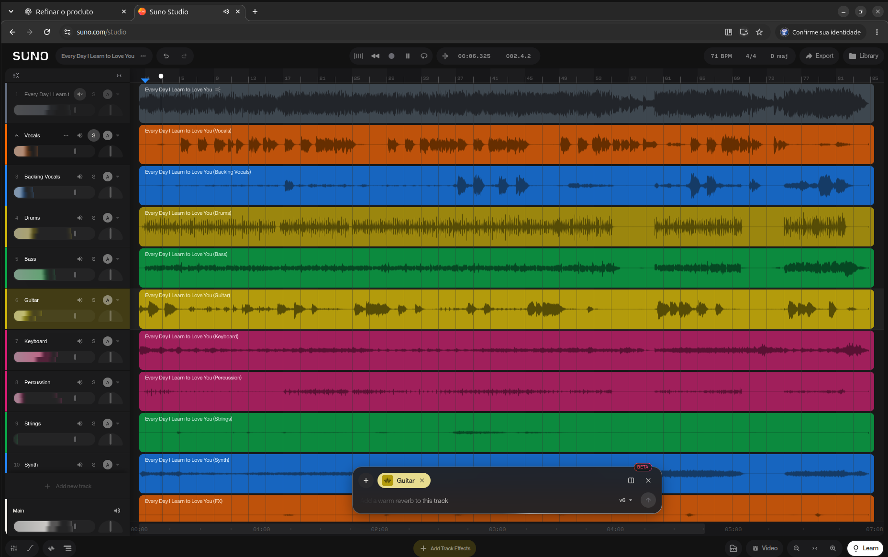
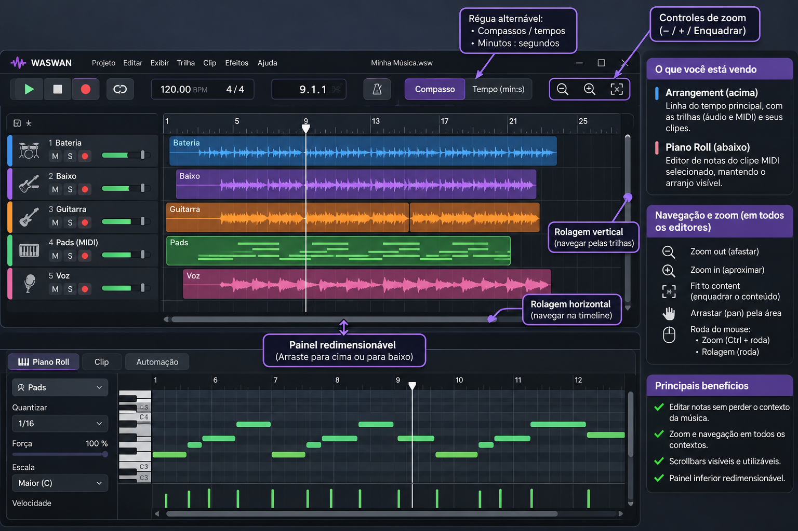
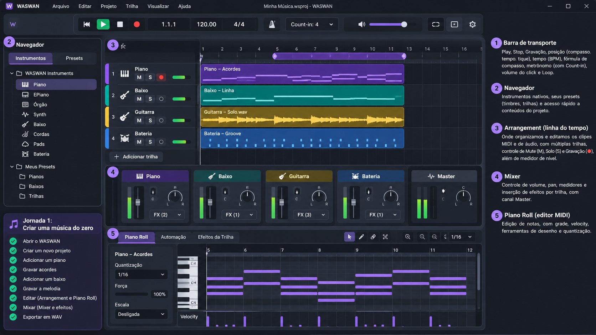
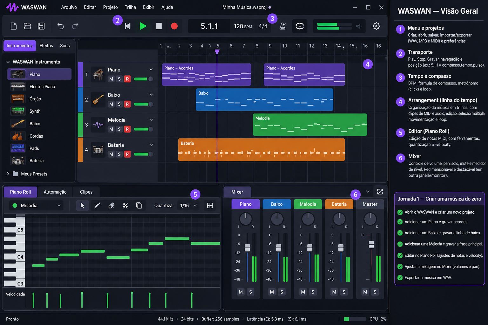

# WASWAN DAW — Referências de UX e imagens

> **IMPORTANTE:** imagens geradas por IA são **wireframes de intenção**. Elas têm problemas de posicionamento, escalas, quantidade de painéis e estados. **Não copiar pixel a pixel.** Requisitos e comportamentos aprovados estão em `SPEC.md`.

## 1. Princípio de design

**Compor primeiro, aprofundar depois.** O Arrangement mantém o contexto musical. Um painel de instrumento, clipe, Piano Roll, automação, Mixer ou FX abre sob demanda, ocupa o espaço necessário e pode ser recolhido, expandido ou destacado.

A UI atual do projeto foi considerada **funcional, mas inconsistente e pouco ergonômica**. O novo workspace não deve simplesmente reproduzir a disposição interna das funções do Legacy SMK-37. A interface nova deve ocultar complexidade, não esconder funcionalidades sem alternativa.

## 2. Referência externa — Suno Studio (fornecida pelo usuário)



**Aproveitar como inspiração conceitual:**

- Trilha horizontal, nome e controles à esquerda; conteúdo alinhado em timeline comum.
- Waveforms e distinção clara entre faixas; linha do tempo sempre visível.
- Leitura rápida da estrutura musical e posição de reprodução.

**Não copiar:** interface comercial, marcas, identidade visual ou comportamento de geração de música do Suno. A referência foi fornecida apenas para estudo de UX de um projeto pessoal.

## 3. Conceito 1 — Arrangement e Piano Roll dividindo a tela



**Decisões validadas com este desenho:**

- Arrangement superior; Piano Roll inferior redimensionável.
- Régua alternável musical/cronológica.
- Scrollbars visíveis e zoom horizontal/vertical adequados aos editores.
- Transport bar persistente e playhead.
- Velocity em área inferior do Piano Roll.

**Não reproduzir:** caixas de explicação laterais, anotações roxas ou qualquer texto explicativo como parte da UI final; são elementos de apresentação. O design final precisa comportar telas menores.

## 4. Conceito 2 — Jornada de criação de uma música



**Aproveitar:**

- Agrupamento visual de funções: transporte, biblioteca, trilhas, edição, mixagem.
- Hierarquia clara entre área principal e ferramentas contextuais.
- Ícones, nomes e cores dos papéis musicais; medidores associados às trilhas.
- Capacidade de selecionar notas no Piano Roll e editar velocity.

**Corrigir obrigatoriamente:**

- **Não mostrar Browser + Mixer + Piano Roll permanentemente abertos** como layout obrigatório; desperdiça área de composição.
- **Não armar todas as trilhas** como se a DAW estivesse gravando tudo. O fluxo principal grava uma trilha por vez.
- Evitar UI demonstrativa com checklist fixo da jornada ocupando o espaço do músico.
- Exibir controles reais de zoom, scroll horizontal e vertical, divisórias arrastáveis e estados de recolhimento/destaque.
- Marcação MIDI vs áudio deve corresponder à natureza da trilha, não apenas à cor/desenho.

## 5. Conceito 3 — Alternativa compacta, com Mixer visível



**Aproveitar:**

- Topo consistente e compacto; Arrangement permanece central.
- Biblioteca lateral recolhível.
- Possibilidade de Mixer no mesmo workspace quando o usuário quiser mixar.
- Barra de status com pistas técnicas **discretas**, quando diagnósticos forem úteis.

**Corrigir obrigatoriamente:**

- A imagem ainda mostra **Piano Roll e Mixer simultaneamente**; no layout padrão, **um painel inferior ativo por vez**, com opção de organização avançada em telas largas e destacamento em outra janela.
- Números grandes e legenda lateral são **anotações**, não parte da interface.
- Botões `R` ativos simultaneamente contradizem a decisão de gravação sequencial.
- Vários indicadores são ilustrativos, inclusive números de latência/CPU: **não usar números falsos** ou fixos no produto.
- É obrigatório projetar affordances de resize, scroll, zoom, menu `Exibir → Painéis`, `Reset Layout` e retorno de janelas destacadas.

## 6. Layout operacional desejado (sem arte final obrigatória)

```text
┌──────────────────────────────────────────────────────────────────────────────┐
│ WASWAN  Arquivo Editar Exibir ...  Undo Redo  ▶ ■ ●  05.1.1  120 BPM  4/4 │
│                                    Loop  Click  Count-in  Projeto salvo      │
├───────────────┬──────────────────────────────────────────────────────────────┤
│ Biblioteca ⟵  │ Régua musical / segundos  [- Zoom +] [Enquadrar]            │
│ [recolhível]  ├──────────────────────────────────────────────────────────────┤
│ Instrumentos  │ Piano MIDI   M S R   [notas e clipes]                        │
│ Sons          │ Baixo MIDI   M S R   [notas e clipes]                        │
│ Presets       │ Guitarra AUD M S R   [waveform / região]                     │
│               │ Bateria MIDI M S R  [clipes]                                 │
│               │                           ... Scroll vertical / horizontal  │
├───────────────┴────────────────────────── ⇕ divisória ──────────────────────┤
│ [Piano Roll] [Clipes] [Automação] [Mixer] [Efeitos] [⤢] [Destacar] [Fechar] │
│                               EDITOR ATIVO                                  │
│                        (zoom e scroll independentes)                         │
├──────────────────────────────────────────────────────────────────────────────┤
│ Estado da sessão / diagnósticos sob demanda                                  │
└──────────────────────────────────────────────────────────────────────────────┘
```

Esse desenho ASCII indica **hierarquia e comandos**, não medidas ou layout final de pixel.

## 7. Comportamento de painéis

- Arraste da **divisória** ajusta tamanho; cursor muda para `resize` e há área de pega acessível.
- Um botão **Destacar** abre a superfície em janela Chrome separada (user move ao monitor desejado).
- Botão **Recolher** mantém tab/ícone com tooltip, nome e estado quando necessário.
- **Maximizar** dá prioridade temporária à tarefa sem perder projeto.
- `Exibir → Painéis` lista e reabre painéis, inclusive os fechados.
- **Reset Layout** reorganiza UI somente; nunca muda áudio, notas, FX, projeto ou presets.
- **Scrollbars e zoom** sempre compatíveis com a área; o cursor mantém âncora quando o zoom muda.
- O pane destacado **não inicializa outro motor de áudio**; a Onda 0 deve definir propriedade de sessão e comportamento de fechamento da janela hospedeira.

## 8. Pistas visuais (clues / affordances) obrigatórias

| Ação | Sinal esperado |
|---|---|
| Arrastar clipe | Preview do novo começo, duração e snap |
| Split | Linha de corte no playhead/cursor e indicação textual |
| Trim | Cursor/alça próprios, não confundir com Move |
| Repetir Loop | Alça distinta, divisórias e rótulo `Loop × N` |
| Multi-seleção | Realce claro, inclusive com múltiplas cores de trilha |
| Arm / Monitor | Estado facilmente reconhecível; sem armar tudo por padrão |
| Zoom | Botões explícitos +/−/Enquadrar, além de atalho/gesto |
| Scroll | Barras visíveis; não depender só da roda |
| Redimensionar painel | Divisória com área de pega e cursor correspondente |
| Painel recolhido | Tab/ícone que permita reabrir sem memorizar atalho |
| Painel destacado | Referência de onde está e comando de retorno/recuperação |
| Salvamento | `dirty`, `saving`, `saved`, `error` claros e verdadeiros |
| MIDI Pickup | Indicação de espera/captura e controle ativo |

## 9. Filosofia visual

- Interface escura e sóbria, boa densidade de informação **sem** saturar as telas.
- Cores distinguem trilhas e seleção, mas informação importante também é expressa por ícones, nomes, contornos e tipografia.
- Componentes reutilizáveis, sem impor “design system corporativo” pesado.
- **Não colar uma pequena tela de teclado em todas as páginas.** O teclado virtual é ferramenta opcional, não estrutura fixa.
- **Não mostrar controles inertes.** Uma função ainda não existente deve ser omitida, desativada com explicação clara ou explicitamente marcada como planejada — jamais fingir funcionamento.

## 10. Checklist de revisão visual do Codex

- [ ] Em notebook, é possível ver uma quantidade útil de trilhas e manipular a timeline sem abrir vários painéis?
- [ ] Em 1080p, editor inferior e Arrangement têm navegação e zoom independentes?
- [ ] Em ultra-wide, o espaço extra é bem utilizado sem espalhar excessivamente controles?
- [ ] O que está recolhido pode ser encontrado novamente, inclusive após destacar e fechar janelas?
- [ ] Todas as operações de clipe têm cursor, alça, tooltip ou preview que indique sua intenção?
- [ ] O painel selecionado não perde foco ou gera atalhos acidentais?
- [ ] Os estados dos dispositivos, do transporte e do projeto são reais, não ilustrações estáticas?
