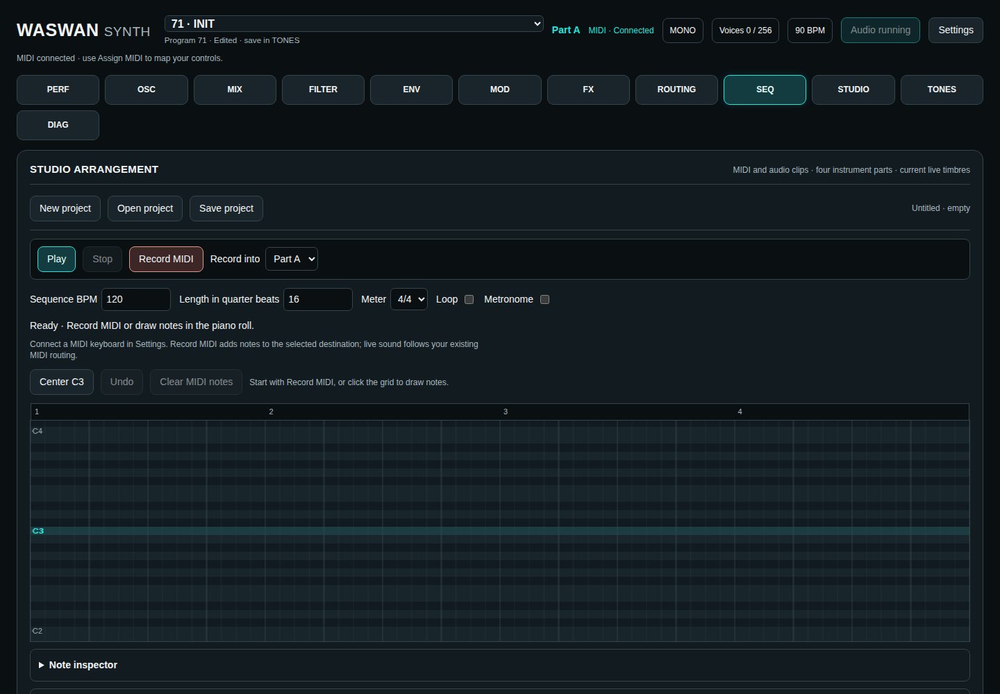
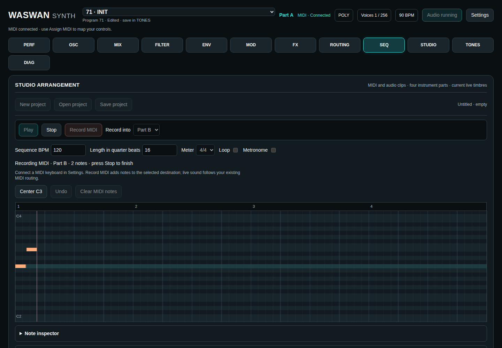

# WASWAN Studio — revisão da experiência do SEQ

Estado: implementado na branch `feat/studio-seq-ux`, dependente das ondas em `c6e3c67`. Sem integração na main. Revisão solicitada pelo usuário após não encontrar como limpar o projeto e gravar o teclado. Escopo: projeto, captura MIDI, transporte e orientação no piano roll, preservando a base sonora.

## Pesquisa e plano revisado

Foram consultados os manuais oficiais de [gravação do Ableton Live](https://www.ableton.com/en/manual/recording-new-clips/), [gravação MIDI do FL Studio](https://www.image-line.com/fl-studio-learning/fl-studio-online-manual/html/recording_scores.htm) e [organização da janela do Logic Pro](https://support.apple.com/en-mide/guide/logicpro/lgcp2a07a994/10.7/mac/11.0).

Ableton explicita a pista de destino e o transporte de gravação. FL Studio descreve Record/Play para registrar notas recebidas do controlador no piano roll. Logic separa organização em pistas e edição de regiões MIDI. A síntese adotada aqui é uma decisão de produto: projeto e transporte juntos, destino explícito, feedback de captura e editor próximo; funções secundárias recolhidas. Isso adapta o fluxo às quatro partes já existentes, sem replicar toda uma DAW.

Aplicada a skill Product Design Audit, com screenshots novos da aplicação antes da implementação. A captura via Chrome/Playwright foi explicitamente autorizada pelo usuário. A revisão do plano e da entrega foi feita pelo advisor **gpt-6.1-sol, esforço high**, conforme solicitado. O advisor aprovou a direção e identificou Stop indisponível na fase inicial de preparação, retorno horizontal incompleto ao criar projeto e ambiguidade da seleção de parte; os três pontos foram corrigidos. Sua revisão independente usou código, capturas e relatórios; seu Chrome não iniciou no sandbox. Os ensaios de navegador abaixo foram executados pelo agente principal.

## Auditoria do fluxo anterior

| Passo | Saúde observada | Evidência e decisão |
|---|---|---|
| 1. Começar outra composição | Incompleto: não havia New project | [01 — entrada](assets/studio-seq-ux/01-before-desktop.png). Adicionar ação explícita que abrange todos os dados Studio |
| 2. Registrar teclado MIDI | Pouco descobrível: Overdub por parte se misturava a mixer/clipes | [01](assets/studio-seq-ux/01-before-desktop.png). Record MIDI e destino no transporte principal |
| 3. Ver/editar notas | Editor fora da primeira tela, aberto nas oitavas C8/C9 | [02 — roll](assets/studio-seq-ux/02-before-piano.png). Subir roll e centralizar C3 após a apresentação real |
| 4. Usar viewport estreito | Refluxo existente, mas ações/textos empurravam a tarefa principal | [03 — mobile](assets/studio-seq-ux/03-before-mobile.png). Recolher ferramentas secundárias e reduzir textos/ações do topo |

Todas as imagens foram abertas e inspecionadas. A medição mostrou que a centralização antiga acontecia antes de o painel ter altura útil. Fontes e atalhos de contexto físico permaneceram fora desta alteração.

## Implementação e decisões

- Barra de projeto com **New project / Open project / Save project** no SEQ; New também existe em Studio e usa a mesma ação.
- Transporte com **Play / Stop / Record MIDI**, destino A–D, BPM, métrica, Loop e metrônomo. Record MIDI adiciona notas à composição e conserva tomada/eventos brutos. Não confundir com Record take (captura livre em Studio) nem Record arrangement (resultado sonoro com cauda em Export & recovery).
- Estados Preparing, Recording e Finalizing; prevenção de clique duplo e nova captura até a incorporação terminar. Stop funciona durante preparação e a ação Stop recording em Studio finaliza a mesma sessão MIDI. Uma captura interrompida incorpora as notas recuperadas da tomada parcial quando disponível; falha conserva a recuperação explícita e limpa o estado de captura.
- Piano roll antes do mixer, régua de compassos alinhada e sincronizada com rolagem horizontal, C3 destacado, botão **Center C3** e feedback temporário laranja durante a execução. O modelo final continua vindo de `addTake`; o preview não substitui nem quantiza os eventos gravados.
- Na convenção já usada pelo app, C4 = MIDI 60 e **C3 = MIDI 48**. Centraliza na primeira apresentação, em New e ao iniciar Record; se oculto, aguarda altura válida. Atualizações e notas não movem a vista. Center C3 preserva a posição horizontal; New volta ao compasso 1.
- **Clear MIDI notes** remove notas/clipes MIDI e sua expressão, com confirmação e Undo; conserva áudio, automações e tomada. É diferente de New project.
- Note inspector, Tracks & clips, Automation, Audio clips e Export & recovery ficam em `
` nativos. Selecionar/desenhar uma nota abre o inspector. Controles existentes e exportações continuam funcionais.
- Novo projeto limpa composição, clips, expressão, automação, assets em memória, caches, seleções, histórico, preview, tomada, player e codificação MP3. Volta a 120 BPM, 4/4, quatro compassos, Loop/metrônomo desligados e Part A. Não reinicia AudioContext/WASM, não aplica timbre/mixer, não remapeia MIDI e não libera notas físicas. Havendo playback Studio, encerra apenas suas fontes/vozes.
- New pede confirmação quando há conteúdo e fica bloqueado durante gravação, finalização, carregamento e preparação/importação de áudio. Open/Recover validam o candidato antes de pedir descarte; erro/Cancel preservam os dados e o playback atual. OPFS e a cópia local não são apagados por New; recuperação continua explícita.
- Escolher destino B define onde guardar notas e a parte desenhada no editor. O som vivo segue o roteamento MIDI existente; nenhuma seleção ou atribuição do instrumento é alterada silenciosamente. O hint explica essa distinção.
- Um hook observacional no callback já existente do recorder alimenta `LiveNotes`. Não foi instalado outro listener global que pudesse desligar a gravação. Preview tem limite de 4.096 notas, sem trabalho na thread de áudio; raw timing/projeto continuam autoritativos.

## Resultado visual

1. **Projeto e orientação — bom no desktop.** Projeto, transporte e roll aparecem juntos; C3 está no centro. [04 — vazio](assets/studio-seq-ux/04-after-empty-desktop.png).
2. **Captura — bom em software.** Destino B, estado Recording e notas temporárias são visíveis sem procurar Overdub nas linhas do mixer. [05 — gravando](assets/studio-seq-ux/05-after-recording.png).
3. **Edição e ferramentas — bom com divulgação progressiva.** Inspector abre por seleção; demais ferramentas estão em seções rotuladas. [04](assets/studio-seq-ux/04-after-empty-desktop.png).
4. **Viewport estreito — funcional, ainda exige rolagem vertical.** Sem overflow da página; roll tem rolagem própria e C3 central. [06 — mobile](assets/studio-seq-ux/06-after-mobile.png). Não foi feita uma interface móvel nativa nem validação em telefone real.

## Validação efetivamente realizada

Evidências em `.local/validation/studio-seq-ux/`. Chrome 157.0.8103.78, perfil temporário, WASM/AudioWorklet reais, entrada MIDI simulada.

- PASS 19 suites Node: nova prova de preview (note-on/off, velocity zero, retrigger, parte, pre-roll, limite e loop) e as 18 regressões anteriores: formatos, PCM, captura, relógio, contexto, automação, arranjo, áudio, perfis/pickup, timbres, DSP Monitor e 256 vozes.
- PASS onze suites Chrome anteriores; novas seções são abertas explicitamente nos testes de ferramentas avançadas. UI Foundation v1/v2, timbres e 256 vozes preservados. `sh tests/build-ui-reference.sh` executado; comparação de áudio Node continua idêntica à referência.
- PASS nova suite `browser-studio-seq-ux`: C3 geométrico com tolerância de 3 px em desktop/mobile; régua/rolagem; scroll manual preservado; retorno a compasso 1; New/Cancel e arquivo inválido; nota viva e contexto único preservados; descarte de assets/automação/tomada/histórico; recuperação OPFS após New; destino B e notas visíveis durante captura; raw take exportável; Cancel em Preparing com resposta de contexto atrasada 500 ms; Stop entre telas; captura interrompida com notas parciais recuperadas.
- As suites de arranjo, sequência e gravação foram repetidas após unificar Stop; suite nova e fluxos com rótulos Play/Stop/Loop também foram repetidos. Logs distinguem baseline e rodadas finais.

### Limites da evidência

Não houve ensaio com controlador ou saída físicos, leitor de tela ou telefone real. Screenshots não certificam acessibilidade: foram verificadas estrutura nativa de details, rótulos, foco visível e operação dos controles, mas não há declaração WCAG. Preview pode diferir do modelo final por arredondamento de ticks; não é uma medição acústica. Não foram reexecutados os ensaios de 20 minutos nesta mudança de UX, nem alterado o DSP/encoder. Limites de áudio/formato das ondas anteriores permanecem.

## Registro de fechamento

- **Implementado:** organização por tarefa, projeto novo completo, abertura protegida, transporte com Record MIDI/Stop, preview, C3, régua e seções secundárias.
- **Efetivamente testado:** 19 suites Node e 12 Chrome distintas, incluindo regressões e os cenários novos acima; evidências antes/depois salvas e inspecionadas.
- **Limitado:** desktop primeiro; mobile exige scroll; entrada MIDI externa na captura de notas; avaliação física e com tecnologia assistiva pendente.
- **Decisões:** preservar instrumento/mappings/OPFS; New e Clear notes separados; dados gravados como fonte final; controles avançados em details; sem novo framework ou DSP.
- **Próximo passo:** usuário avaliar **New project → Record MIDI → Stop → Save project** com seu controlador; integrar na main somente com aprovação explícita.
