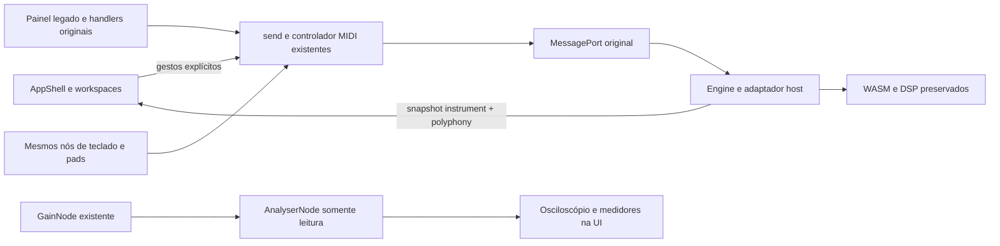

# WASWAN Synth — UI Foundation v0.1

## Escopo e referência

Branch: `feat/ui-foundation-v1`. Base funcional: **`7dc36c8d97eb19ac084d5401864d51532a5c16e6`**, com 256 vozes, DSP Monitor, diagnóstico MIDI e captura suave. O fetch não encontrou uma referência funcional posterior; `docs/ux-audit` e `docs/contributor-guide` acrescentavam somente documentação. O guia AGENTS.md foi preservado nesta branch. Não houve merge, tag, expansão do DSP ou atualização do submódulo `3f751bc2be066414f204cf44e1aa05d9c7467d7f`.

Consultados: [auditoria no SHA publicado](https://github.com/verner-becker/waswan-synth/blob/d16a3c3/docs/ux-audit.md), seu inventário de 62 capturas, diagrama, fontes do painel, MIDI, persistência e processamento. As três imagens fornecidas pelo usuário foram referências visuais, conforme alinhado; não representam funcionalidades disponíveis. “Sawyer-centric” significa priorizar sua experiência de uso. A shell é em inglês, com foco inicial no SMK-37 Pro de oito knobs e quatro faders.

## Arquitetura e reutilização



- `web/ui-foundation.js`: composição, navegação, integração e MIDI Learn. Uma instância do instrumento; os workspaces não iniciam motores próprios.
- `web/ui-primitives.js`: primitivas sem dependência de WASM, recebendo valores, limites e callbacks.
- `web/ui-controls.js`: catálogo de 12 destinos host e apresentação de valores.
- `web/ui-chords.js`: reconhecimento pequeno de conjuntos de classes de altura.
- `web/ui-foundation.css`: tokens e composição responsiva, sem framework ou dependência de produção nova.
- `scripts/stage-simulator.sh`: copia as extensões e injeta montagem/recepção em âncoras verificadas do app derivado. O upstream continua intacto.
- `web/engine.js` e `wasm/waswan-sim.c`: snapshot aditivo `instrument` e contrato de edição host. Não alteram filtros, osciladores, envelopes, alocação ou formatos de armazenamento.

Navegar muda somente `workspace`, visibilidade e seleção dos botões. Não envia comandos ao motor. O teclado de 37 teclas, 16 pads, velocity e respectivos handlers são os originais: seus nós são movidos **uma vez, antes do áudio**, para um dock compartilhado. Não são recriados ao alternar telas.

**Legacy SMK** alterna o painel na mesma sessão, mantendo display, encoders, rodas, faders, botões e operações originais. Teclado e pads permanecem no dock compartilhado. A composição original completa também está disponível em `?legacy=1&lang=pt`; essa URL é referência separada e recarrega a página, ao contrário do botão da shell.

## Design system e primitivas

Tokens principais: grafite `#0a0f12`, painel `#121b20`, borda `#34454d`, texto `#f2f5f6`, secundário `#a9b8bf`, destaque `#27e3dd`; raio 14 px, espaçamento 14/18 px e knob 94 px, reduzido a 88 px em viewport estreito. Fonte de sistema, preferindo Inter/Segoe UI/Arial; sem download de fontes.

| Primitiva | Contrato e comportamento |
|---|---|
| RotaryKnob | Arco canvas de 270°, restante cinza, ativo branco; valor e escala interna; arrasto vertical, Shift para arrasto fino, setas ±1, Page Up/Down ±10, Home/End. Scroll não edita parâmetros. ARIA acompanha o snapshot. |
| VerticalFader | Range nativo vertical, preenchimento branco e indicador ciano; teclado e pointer nativos; min/max/valor e callback externos. |
| MidiMapBadge | Associação explícita ou contextual conhecida, estado de captura e acesso ao aprendizado; não instala mapeamentos automaticamente. |
| AppShell / TopBar | Estrutura e estado real do instrumento. |
| WorkspaceNavigation | Onze focos; Tab/Enter e setas/Home/End; seleção por `aria-pressed`. |
| Panel / SectionHeader | Agrupamentos e títulos componíveis. |
| StatusIndicator / CompactMeter | Estado textual e medida real; sem animação decorativa de áudio. |
| PlaceholderWorkspace | Área planejada identificada, sem editor fictício. |
| BottomPerformanceDock | Mesmos controles originais de execução em todos os focos. |

Oito knobs cabem em uma linha em desktop largo; em larguras intermediárias são duas linhas e em 390 px são quatro. Faders, painéis e dock reorganizam-se sem overflow horizontal global. A visualização mobile é rolável; não substitui a ergonomia do teclado MIDI físico.

## Controles reais e contrato host

| ID | Destino | Faixa interna / escopo |
|---|---|---|
| 0 | Cutoff | 0–127, parte ANALOG selecionada; Hz vêm de `CUT_HZ[value+8]`. |
| 1 | Resonance | 0–127, parte ANALOG selecionada. |
| 2 | Filter env | 0–127; apresentação bipolar em relação a 64. |
| 3 | Amp release | 0–127; milissegundos da tabela original `TIME_MS_X10`. |
| 4–6 | Chorus / delay / reverb send | 0–127, envios da parte selecionada; não são o mix global dos efeitos. |
| 7 | Master | ADC 0–1023; mantém a curva quadrática original. O percentual indica posição, não ganho linear. |
| 8–11 | Part A–D level | Mixer 0–127, parte fixa; **100 = unity**, distinto do volume do patch. |

Mensagens `ui-control` validam ID, inteiros, limites e escopo parte/programa. O setter usa `set_param_in`, `auto_rec`, `mix_apply` ou `sim_master` existentes. Edições com escopo antigo, MIDI MODE, Save As ou navegação de parte/preset pendente são recusadas nos casos previstos pelo contrato. Não se navega pelo display para editar cutoff. Em DRUM-X, os quatro knobs ANALOG ficam indisponíveis, sem valores enganosos.

O snapshot inclui nome real, programa, marca de edição do patch, BPM, transporte e controles. A marca **Edited** é do patch; não pretende representar todos os estados de mixer, sessão ou gravação pendente.

## Perfis e aprendizado MIDI

Os destinos existentes `enc:0..7` e `fader:0..3`, formatos e comportamentos permanecem válidos na chave `waswan-midi-profile-v1`. Não foram convertidos em destinos semânticos: K1 continua seguindo a página original. O badge identifica esse vínculo quando é possível comprová-lo pelo snapshot; Settings lista todas as atribuições e permite reatribuir.

Novos destinos optativos `control:cutoff`, `control:resonance`, `control:filter-env`, `control:release`, `control:chorus-send`, `control:delay-send`, `control:reverb-send`, `control:master` e `control:level-a..d` são independentes da página legada. O mesmo perfil os persiste; nenhuma associação de fábrica é imposta.

**Assign MIDI → formato → Learn control → mover um controle → Close.** Aprender captura somente a identidade. O perfil é ativado explicitamente por essa ação. Usar uma fonte já atribuída substitui a atribuição anterior dessa fonte, conforme o contrato existente.

Para os novos destinos, absoluto sempre usa posição normalizada com captura suave: aguarda alcançar/cruzar o valor, inclusive quando um CC é pulado. Mudanças externas, revisão do perfil ou escopo rearmam a captura. Relativos 65/63 e 1/127 usam ±1 unidade em Fine e ±2 em Normal, sem aceleração adicional. **Normal dos destinos legados mantém a aceleração original.** No master, 128 posições de CC absoluto não oferecem 1024 posições físicas distintas.

## Telemetria e acordes

O AnalyserNode é um ramo do GainNode existente, sem segunda conexão à saída, sem mensagens por bloco e sem processamento adicional no callback do DSP. A UI lê uma janela de 1024 amostras, no máximo a 20 Hz, somente em Performance visível. RMS e pico são da análise mono do output pós-master, em dBFS com piso de −120; não são LUFS, true peak ou medidores do hardware. Picos entre leituras podem ser perdidos. A waveform mostra áudio real.

Acordes: templates exatos para tríades maior, menor, diminuta, aumentada, sus2/sus4 e tétrades 7, maj7/m7. Usa vozes ANALOG com gate da parte selecionada, excluindo sequenciadas, mas incluindo sustain; não equivale a teclas pressionadas nem garante audibilidade. Mostra conjunto de notas ou ambiguidade quando não há identificação única entre os templates. Não interpreta tonalidade, inversão, intenção harmônica ou progressões.

## Workspaces disponíveis e limites

- **PERF:** oito knobs, quatro faders, estado real, áudio, acordes básicos, transporte existente, sustain e dock.
- **DIAG:** DSP Monitor, diagnóstico MIDI e grade/modos de polifonia existentes; grade recolhível. Captura e exportação conservam os limites anteriores.
- **OSC / FILTER / ENV / MOD / FX / ROUTING:** seções de Sound Design preparadas e identificadas; edição completa pelo Legacy SMK.
- **MIX / SEQ / TONES:** estruturas de workspace e acesso ao legado; sem novo console, piano roll, automação, cenas ou biblioteca fictícios.
- **Settings:** conexão MIDI existente, lista de atribuições reatribuíveis, ajuda e importação/exportação originais. Ferramentas legadas conservam textos/traduções originais; parte delas ainda está em português.

Navegação visual não é persistida: uma nova carga abre PERF. Não há formato novo de preset/sessão, servidor de controle, MCP ou DSP expandido. Salvar preset e exportar sessão continuam operações diferentes. No boot, um pattern pode restaurar seu próprio conjunto de sons; recuperar o programa salvo comprova seu conteúdo, sem mudar essa regra original.

## Testes e reprodução

Pré-requisitos e ferramentas seguem o README. Reconstruir o WASM é necessário por causa da API host aditiva:

```sh
sh scripts/setup-tools.sh
sh scripts/build-simulator.sh
sh tests/build-ui-reference.sh
node tests/ui-foundation.test.mjs
sh scripts/check-upstream.sh
python3 scripts/serve-simulator.py
node tests/browser-ui-foundation.mjs
```

A referência de áudio é recompilada diretamente do wrapper de `7dc36c8`, com o mesmo upstream, patch de 256 e flags. Também se comparou com a cópia do artefato local anterior ao build.

**Resultados desta fase:**

| Verificação executada | Resultado |
|---|---|
| `ui-foundation.test.mjs` | PASS: 12 destinos, limites/escopo, perfis antigos, captura suave, relativos e templates. **256.000 amostras escalares idênticas** à referência anterior; armazenamento com mesmo formato. |
| `midi-profile`, `midi-diagnostic`, `knob-fine-control`, `knob-pickup` | PASS nas quatro suítes Node. |
| `polyphony`, `polyphony-16/32/64/128/256` | PASS nas seis etapas; alocação, sustain, release, roubo e regressões aplicáveis. |
| `dsp-monitor.test.mjs` | PASS; **384.000 amostras escalares por modo** idênticas entre off/live/capture. |
| `check-upstream.sh` | PASS em MIDI original e release demo; integridade do submódulo conferida separadamente. |
| Chrome: `browser-ui-foundation.mjs` | PASS: navegação, teclado, mouse, toque, faders, MIDI Learn, captura suave, reload, mute, retomada do mesmo AudioContext, SAVE/recall, export/import de sessão e JSONL DSP. |
| Continuidade na shell | Quatro gates mantidos entre todos os módulos e Legacy; **1 AudioContext, 1 ready, zero comandos enviados pela navegação**, programas/escopo e nós de execução preservados; áudio real não nulo. |
| Chrome: knob fine/pickup, polyphony-256 e MIDI diagnostic | PASS; foco/reconexão, perfis, 256 vozes, exportação local e idempotência. |
| Chrome: `browser-dsp-monitor.mjs` | PASS: **180.094 ms de áudio**, 180 janelas, 256 vozes; heap retido 3.075.716 → 2.957.988 bytes após GC; limite sintético de 3.600 janelas, restart/ocultação/exportação e ausência de exceções. |
| Responsividade | Chrome real 1560×1100 e 390×844; sem overflow horizontal global na Performance. |

Chrome **157.0.8103.78**, headless, contextos isolados com MIDI sintético; nenhum perfil pessoal foi alterado. Testes legados usam `?legacy=1&lang=pt`, sem mudar suas asserções musicais. O ensaio prolongado foi do monitor no modo legado; a shell recebeu o ensaio específico de navegação, não um soak de horas. Os números de CPU do benchmark legado não medem o custo isolado da nova UI; não se declara um overhead da shell a partir deles.

Para reproduzir o diagnóstico MIDI: iniciar outro servidor com `--port 8738 --diagnostic-dir .local/validation/midi-diagnostic-server` antes de `node tests/browser-midi-diagnostic.mjs`. Os demais testes de Chrome usam 8737. Executar cada `node tests/<nome>.test.mjs` da tabela após o build; `browser-dsp-monitor.mjs` leva aproximadamente cinco minutos. Evidências brutas, logs e sessões exportadas ficam em `.local/validation/`, ignorados pelo Git.

## Evidências e validação física

Somente cinco screenshots reais foram selecionados para versionamento:

1. [Performance desktop](assets/ui-foundation/performance-desktop.png).
2. [Performance viewport menor](assets/ui-foundation/performance-mobile.png).
3. [Sound Design preparado](assets/ui-foundation/sound-design.png).
4. [Sequencer preparado](assets/ui-foundation/sequencer.png).
5. [Legacy SMK na mesma sessão](assets/ui-foundation/legacy.png).

Nenhuma captura é mockup ou telemetria decorativa. Acorde, teclas e waveform das capturas são gerados por entrada MIDI sintética explicitamente usada nos testes. Revisão visual em [design-qa.md](../design-qa.md).

**Pendente somente de avaliação física pelo usuário:** ligar o SMK-37 Pro, abrir o simulador, Start audio, Settings e conectar a entrada Master. Conferir os vínculos antigos; experimentar Assign MIDI em um novo destino, alcançar a captura e percorrer os extremos. Tocar um acorde e alternar os workspaces/Legacy. Nenhum teste físico desta nova interface é declarado executado.

## Próximos incrementos sugeridos

Após revisão: seleção direta de parte/preset e modos no cabeçalho; primeira seção Filter dedicada; maior ergonomia do dock estreito; uniformização do idioma das ferramentas antigas; extração gradual do compositor em módulos conforme necessário. Novos osciladores, LFOs, efeitos, automação ou polifonia continuam fora desta fase e exigem autorização própria.

## Arquivos desta entrega

- Novos componentes: `web/ui-foundation.js`, `web/ui-foundation.css`, `web/ui-primitives.js`, `web/ui-controls.js`, `web/ui-chords.js`.
- Integração: `web/engine.js`, `web/midi-profile.js`, `web/midi-profile-panel.js`, `wasm/waswan-sim.c`, `scripts/stage-simulator.sh`.
- Novos testes: `tests/ui-foundation.test.mjs`, `tests/browser-ui-foundation.mjs`, `tests/build-ui-reference.sh`. Seis testes legados de navegador receberam somente a URL explícita do modo legado.
- Documentação: este relatório, `design-qa.md`, README, cinco capturas e seu índice; AGENTS.md preservado da branch de documentação.

Commits de implementação: `2cfffbf`, `6635379`, `788a970`; testes: `e2c73d8`. O commit final de documentação é informado na entrega e pode ser consultado no histórico da branch.
