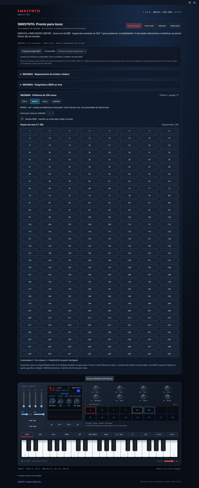
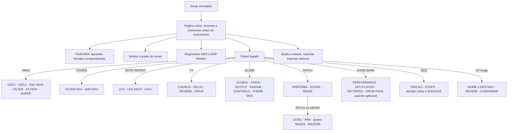
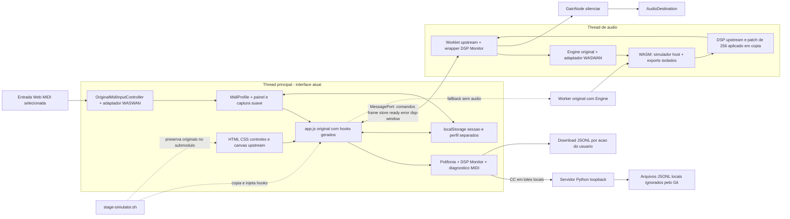

# WASWAN Synth — auditoria de UX e arquitetura de interface

## 1. Resumo executivo e escopo

**Versão auditada:** [`7dc36c8d97eb19ac084d5401864d51532a5c16e6`](https://github.com/verner-becker/waswan-synth/commit/7dc36c8d97eb19ac084d5401864d51532a5c16e6), branch funcional `feat/knob-fine-control`. Contém o experimento de 256 vozes, DSP Monitor, diagnóstico MIDI e correção dos knobs absolutos com captura suave. Não é a `main`. Branch desta entrega: **`docs/ux-audit`**, criada diretamente desse SHA após conferir árvore limpa e igualdade com o remoto.

Upstream preservado: [SMKSYNTH, commit `3f751bc2be066414f204cf44e1aa05d9c7467d7f`](https://github.com/4t59m4f784-creator/SMKSYNTH/tree/3f751bc2be066414f204cf44e1aa05d9c7467d7f). Nenhuma alteração de produção, firmware, DSP, MIDI, presets ou comportamento musical nesta branch. Alterações somente neste relatório, diagrama e evidências documentais.

**Conclusão:** existe um instrumento funcional e uma base técnica aproveitável, mas a interface ainda organiza o trabalho como uma reprodução do hardware, acrescida de painéis de engenharia. A tarefa principal — tocar e editar um timbre — fica visualmente subordinada à configuração e à grade de vozes. O primeiro incremento de maior valor é **reorganizar a composição visual**, preservando controles e handlers: instrumento em primeiro plano, estado compacto de MIDI/vozes e diagnósticos recolhíveis. Criar oito osciladores, uma matriz de modulação ou um novo motor não faz parte desse incremento.

Pontos fortes: motor real no navegador; painel legado reconhecível; suporte a teclado, mouse, toque e MIDI; modos de execução explícitos na extensão; captura suave com feedback; persistência separada de timbres e mapeamentos; diagnósticos optativos com exportação; upstream mantido como referência.

### Método e limites

- Chrome real **157.0.8103.78**, automatizado pela API Node do Playwright já instalada, em modo headless; renderização da aplicação, WASM e AudioWorklet reais. Screenshots desta execução, sem mockups, imagens geradas ou remontagem visual.
- Desktop 1440×1000; viewport menor 390×844. Contexto de navegador isolado, sessão de fábrica e pequenas edições de auditoria. Fonte MIDI sintética identificada como tal nas imagens; nenhum mapeamento, sessão ou dispositivo pessoal foi utilizado.
- Cada imagem salva foi aberta e inspecionada. A captura inicial transitória do DSP Monitor foi descartada e refeita após estabilização. A imagem 48 registra deliberadamente o estado transitório de gravação, seguido de confirmação em 52.
- Percursos por controles reais da UI; encoders com setas do teclado, botões com Enter/pressionamento longo, MIDI sintético pela classe de entrada existente. Nenhum parâmetro foi alterado por edição de código.
- Inventário por famílias cobre a aplicação e seus arquivos; as capturas cobrem todos os painéis web e as principais páginas nativas. Não se testaram todas as combinações dos 99 programas, todos os submodos de sequenciador, hotplug físico, leitor de tela, diferentes sistemas operacionais ou desempenho em dispositivos móveis reais.
- Acessibilidade: inspeção visual, DOM, rótulos, dimensões e navegação por teclado; **não** certificação WCAG nem ensaio com tecnologia assistiva. Viewport estreito não prova suporte a Web MIDI em navegador móvel.
- Não foi feito benchmark novo de DSP nem validação auditiva comparativa nesta fase documental. A contagem de oito vozes foi observada para o fluxo; não se repetiu o stress de 256. O limite de 256 foi confirmado na telemetria e no artefato servido.
- A inspiração Poly D é tratada somente como agrupamento físico por função solicitado pelo usuário, sem auditoria do equipamento ou adoção de suas contagens/topologia.

## 2. Inventário completo da interface atual

Convenção de arquivos: **U** = submódulo `upstream/SMKSYNTH` no SHA acima; **W** = extensão rastreada neste repositório. Os arquivos em `.local/www/` são artefatos gerados, não fontes a editar.

| Recurso existente | Onde e como é acionado | Implementação principal |
|---|---|---|
| Inicialização e estado | Topo: Iniciar, Rever boot, Silenciar, Soltar tudo | U `web/simulator/index.html`, `app.js`, `engine.js`, `worklet.js` |
| Instrumento legado | Painel abaixo das extensões; canvas 240×240, oito encoders, quatro faders, rodas, 16 pads, 37 teclas | U `web/simulator/app.js`, `style.css`; U `web/sim/sim.c`; U `firmware/src/obv_ui.h`, `smk_zoom*.h` |
| Osciladores | PARA percorre OSC1, OSC2, OSC MOD, FILTER, FILTER+, SUPER | U `obv_params.h`, `obervave.c`, `obv_engine.h`, `obv_supersaw.*` |
| Filtro | Cutoff em PERFORM/K1 e banco A de faders; FILTER oferece ressonância/env/key tracking/tipo; FILTER+ drive/velocity/morph | Mesmos arquivos; `CUT_HZ` em U `firmware/gen/obv_tables.h` |
| Envelopes | Botão físico rotulado CHORD alterna FILTER ENV e AMP ENV | U `platform.c` mapeia CHORD→ENV; U `obervave.c`, `obv_params.h` |
| Modulação | NOTE REPEAT abre LFO, LFO DEST e LFO+; OSC MOD e velocity completam rotas fixas | U `platform.c`, `obervave.c`, `obv_params.h`, `obv_engine.h` |
| Arpejador/HOLD | ARP abre página; ARP novamente alterna HOLD; modo, divisão, oitavas e gate | U `obervave.c`, `obv_engine.h` |
| Mixer de quatro partes | PATCH retorna a Performance; em Performance alterna scope e Mixer; PATCH no Mixer percorre sete linhas | U `obervave.c`, `obv_perf.h`, `obv_fx.h` |
| Efeitos | FX percorre chorus, delay, reverb e drive; envios no Mixer e fader bank B | U `obervave.c`, `obv_fx.h`; parâmetros em U `obv_params.h` |
| Saída e polifonia nativas | GLOBE percorre GLOBAL, POLYPHONY, OUTPUT e outros menus | U `obervave.c`, `obv_params.h` |
| Engine ANALOG/DRUM-X | GLOBE→PART SETUP, K1; PARA em DRUM alterna KIT/SOUND; banco manual Drum Pads | U `obv_engine_patch.h`, `obv_drums.h`, `obv_perf.h`, `obv_smk.h` |
| Presets | K7 percorre 99 slots; pads −/+ no banco Performance; BT/SAVE curto salva slot atual; longo abre Save As/nome | U `obv_params.h` (`NPROG=99`, 64 fábrica + 35 INIT), `obv_patches.h`, `obv_perf.h` |
| Favoritos | Oito pads inferiores de Performance: toque recupera, segurar ~0,7 s memoriza | U `obv_perf.h`; LEDs/legendas em U `web/simulator/app.js` |
| Patterns | KNOB BANK→Padrões, 16 pads; toque carrega/agenda, segurar salva/copia, ocupado pede confirmação | U `obv_perf.h`, `obv_seq.h`, `tests/host.c` (16 slots no host); U `app.js` |
| Sequenciador/ENDLESS | SEQ abre Tracks/Steps e demais vistas; PLAY/REC; camadas de edição e captura | U `obv_seq.h`, `obervave.c`, `obv_perf.h`; controles em U `app.js` |
| Split/Layer | KNOB BANK→Split/Layer; duas linhas de partes/modos/PLAY; K5 volumes/oitavas | U `obv_perf.h`, `obv_keyboard.h` e U `app.js` |
| MIDI de entrada web | Conectar e escolher entrada no painel acima do instrumento; notas/velocity, pitch, mod, sustain/panic | U `web/simulator/midi.js` e W [`web/midi.js`](../web/midi.js) |
| Perfil/MIDI Learn | Details WASWAN; ativar, destino, formato, comportamento, aprender/remover; alteração por linha | W [`midi-profile.js`](../web/midi-profile.js), [`midi-profile-panel.js`](../web/midi-profile-panel.js), CSS |
| Fino absoluto/relativo | Escolha Fino em K1–K4; posição absoluta com captura suave; relativos unitários | W [`web/engine.js`](../web/engine.js), [`wasm/waswan-sim.c`](../wasm/waswan-sim.c); setter original |
| Polifonia WASWAN | Painel sempre aberto: POLY/MONO/DUAL/UNISON, unison até 8, sustain, 256 slots | W [`polyphony-panel.js`](../web/polyphony-panel.js), [`polyphony.css`](../web/polyphony.css), Engine/exports host |
| DSP Monitor | Mostrar/ocultar, iniciar/encerrar, exportar JSONL, limpar | W [`dsp-monitor.js`](../web/dsp-monitor.js), [`dsp-worklet.js`](../web/dsp-worklet.js), [`dsp-stats.js`](../web/dsp-stats.js), CSS |
| Diagnóstico MIDI | Details separado: captura ao vivo, marcação, encerrar/exportar | W [`midi-diagnostic.js`](../web/midi-diagnostic.js), W [`scripts/serve-simulator.py`](../scripts/serve-simulator.py) |
| Ajuda e sessão | Details no fim da página; instruções, exportar/importar JSON, reiniciar | U `index.html`, `app.js`, `engine.js` |
| Idioma/atribuição | PT/EN e rodapé SMKSYNTH/instalação/créditos | U `web/site/i18n.js`, `index.html`; cópia pelo staging |
| Ferramentas ocultas | Baseline/compare, contadores de gravação, testes de engine/kit ficam em contêiner `hidden` | U `index.html`/`app.js`; não são biblioteca ou comparação A/B disponível ao usuário |

Os nomes completos de arquivos U e os símbolos citados permitem verificar o inventário no [upstream fixado](https://github.com/4t59m4f784-creator/SMKSYNTH/tree/3f751bc2be066414f204cf44e1aa05d9c7467d7f). O teclado/split/layer é implementado em U `obv_keyboard_config.h`, `obv_perf.h` e `obervave.c`.

### Capacidades musicais: não confundir páginas com módulos independentes

- Quatro partes A–D compartilham o pool experimental de 256 vozes ANALOG. POLY usa uma voz/nota, DUAL duas, MONO uma nota e UNISON até oito vozes sobre a nota. Uma parte tem até 128 alturas MIDI distintas; 256 vozes não significam 256 teclas distintas em um canal. Release ocupa o pool; gate inclui sustain. DRUM-X tem estrutura própria de hits, não contabilizada como voz ANALOG.
- ANALOG tem **dois osciladores**, ruído, sync/x-mod/env→O2 e afinação. SUPER é recurso do OSC1, com limite independente de cinco vozes; não representa oito osciladores editáveis.
- Um filtro por voz, com LP12, HP12, BP12, notch, LP24 e SEM/morph. FILTER+ complementa esse filtro; não é um segundo filtro.
- Dois ADSR: filtro e amplitude. **Um LFO**, seis formas e rotas/depths fixos para pitch/PWM/filtro/amplitude; **LFO+ não é LFO2**, mas seleção de destinos dos osciladores. Não há matriz arbitrária de modulação.
- Mixer: LEVEL, PAN, SEND CHORUS, SEND DELAY, SEND REVERB, SEND DRIVE e MASTER. A cadeia de efeitos é compartilhada; envios são por parte. `ed_patch()` direciona parâmetros de chorus/delay/reverb à parte A; recall de A preserva a cadeia via `fx_keep`. Uma futura UI precisa deixar o escopo global explícito.
- Sequenciador: quatro tracks, até 256 steps por track, quatro notas por step, velocity/gate/tie/ratchet/chance/nudge, lançamento no compasso e ENDLESS. Essa estrutura é diferente de polifonia ao vivo e não cresceu para 256 notas por step.
- Preset, favorito, pattern, sessão e perfil MIDI são objetos diferentes. Não existe hoje uma Tone Library web com busca/categorias, comparação A/B visível ou importação individual de timbres.

## 3. Evidências visuais e percursos

Todas as capturas estão em [`assets/ux-audit/`](assets/ux-audit/). O [índice de evidências](assets/ux-audit/README.md) lista arquivos, dimensões e estado. São imagens reais da aplicação; os recortes de `.display` incluem o canvas do firmware e as setas, sem recomposição.

| Etapa | Fluxo observado | Saúde e referências |
|---|---|---|
| 1 | Abrir e iniciar | Funciona; hierarquia ruim após iniciar: [01](assets/ux-audit/01-desktop-inicial.png), [02](assets/ux-audit/02-desktop-execucao.png), [03 mobile](assets/ux-audit/03-mobile-execucao.png) |
| 2 | Conectar entrada, aprender e capturar posição | Funciona; texto longo e contexto distante: [04 vazio](assets/ux-audit/04-perfil-midi-vazio.png), [05 aprender](assets/ux-audit/05-midi-learn-aguardando.png), [06 aguardando CC20](assets/ux-audit/06-midi-captura-suave.png), [07 sincronizado](assets/ux-audit/07-midi-sincronizado.png) |
| 3 | Diagnosticar MIDI | Captura/conexão/marcação/stop funcionaram: [08](assets/ux-audit/08-diagnostico-midi.png), [09](assets/ux-audit/09-diagnostico-midi-ativo.png) |
| 4 | Consultar vozes e DSP | Estados coerentes com oito notas; espaço excessivo: [10 monitor](assets/ux-audit/10-dsp-monitor.png), [11 captura](assets/ux-audit/11-dsp-capturando.png), [12 vozes](assets/ux-audit/12-polifonia-ativa.png) |
| 5 | Editar som legado | Funciona, navegação pouco descobrível: [14 painel](assets/ux-audit/14-instrumento-performance.png), páginas [15–47 no índice](assets/ux-audit/README.md) |
| 6 | Salvar timbre | Save As/revisão/confirmação funcionam; status web pode ficar antigo: [48 espera](assets/ux-audit/48-preset-save.png), [50 nome/destino](assets/ux-audit/50-preset-save-as.png), [51 revisão](assets/ux-audit/51-preset-review.png), [52 salvo](assets/ux-audit/52-preset-saved.png), [53b barra antiga](assets/ux-audit/53b-status-salvamento.png) |
| 7 | Split/Layer, patterns e sequência | Mudança de contexto/pads funciona, exige aprender bancos: [53](assets/ux-audit/53-split-layer.png), [54](assets/ux-audit/54-patterns.png), [55 tracks](assets/ux-audit/55-sequencer-tracks.png), [56 steps](assets/ux-audit/56-sequencer-steps.png) |
| 8 | Trocar para DRUM-X | KIT/SOUND e Drum Pads acessíveis; terceira taxonomia de contextos: [57](assets/ux-audit/57-drum-kit.png), [58](assets/ux-audit/58-drum-sound.png), [59](assets/ux-audit/59-drum-performance.png), [61](assets/ux-audit/61-drum-pads.png) |
| 9 | Exportar sessão e rejeitar import inválido | Download real efetuado; erro de formato explícito: [13 ajuda](assets/ux-audit/13-ajuda-sessao.png), [60 erro](assets/ux-audit/60-importacao-invalida.png). Não foi feito roundtrip de importação válida nesta execução |

### Visão geral

A imagem longa é intencional: documenta a altura real, sem reduzir ou esconder a grade. A versão [mobile completa](assets/ux-audit/03-mobile-execucao.png) tem 390×6241 px; o painel do instrumento começa aproximadamente em y=4985.

### Controles e estados que parecem iguais, mas não são

| Rótulo/estado | Função observada |
|---|---|
| PATCH | HOME/Performance, scope e Mixer; não abre lista de timbres |
| PARA | Páginas de oscilação/filtro/SUPER, ou KIT/SOUND em DRUM |
| CHORD | Envelopes FILTER ENV/AMP ENV |
| NOTE REPEAT | Páginas LFO/LFO DEST/LFO+ |
| SCALE | SELECT contextual: mais opções, sync em GLOBAL, funções do sequenciador |
| GLOBE | GLOBAL→POLYPHONY→OUTPUT→PART SETUP→FADER MODE→THEME→MIDI MODE |
| BT/SAVE curto | Salva programa atual; não é o mesmo fluxo do pressionamento longo |
| BT/SAVE longo | Nome/destino e revisão antes da confirmação |
| Conectar teclado MIDI | Entrada Web MIDI para tocar o sintetizador |
| MIDI MODE nativo | Modo controlador legado, que suspende o synth; [37](assets/ux-audit/37-midi-mode-config.png), [38](assets/ux-audit/38-midi-mode-ativo.png), [39](assets/ux-audit/39-midi-mode-settings.png) |
| Fino absoluto | Aguarda captura de posição e então usa valor normalizado; proteção de contexto |
| Normal absoluto | Diferenças de posições com aceleração original; não garante alinhamento físico dos extremos |
| Fader CATCH | Captura do valor pelo firmware; diferente da captura dos encoders finos no adaptador |

## 4. Mapa de navegação

São três contextos sobrepostos: **página do display**, **banco/função dos pads** e **camada temporária por botão segurado**. Parte A–D, preset, banco dos faders e modo MIDI acrescentam escopos. Trocar a página não necessariamente troca o banco manual; selecionar DRUM-X não ativa automaticamente Drum Pads. Não modelar tudo como uma única aba selecionada.

As vistas adicionais de sequência (Step+, track, slots, transpose, ENDLESS) e os dois IDs retirados VOWELS/VTONE foram examinados no código; não se capturou cada subvista/combinação. São recursos existentes/legados, não novos módulos web.

## 5. Mapa de componentes, dependências e estados

Diagrama versionável separado: [`ux-audit.mmd`](ux-audit.mmd).

### Acoplamentos principais

1. **`app.js` original concentra composição e operação.** Gera controles, traduz gestos, desenha framebuffer, muda legendas dos pads, trata MIDI, fluxo de boot/erros e localStorage. O canvas é a própria UI C rasterizada; páginas musicais não são componentes JavaScript independentes.
2. **Montagem WASWAN ocorre no construtor MIDI.** `web/midi.js` estende o controlador e monta perfil, diagnóstico, polifonia e DSP Monitor quando há `document`. Reutiliza código, mas faz uma classe de entrada depender da estrutura da página e de componentes sem relação direta com MIDI.
3. **Painéis são singletons de módulo.** Referências globais (`controller`, `panel`, `activeProfile`, `current`) e seletores DOM globais favorecem uma instância por página. Não há suporte arquitetural pronto para múltiplos instrumentos/workspaces simultâneos.
4. **Integração por staging.** `scripts/stage-simulator.sh` copia originais, conserva `midi-original.js` e `engine-original.js`, exporta uma cópia da classe do worklet e injeta hooks em âncoras textuais de `app.js`. As âncoras são verificadas. Atualizar upstream requer revisar esses contratos; não editar `.local/www` como fonte.
5. **Porta com comandos e snapshots.** UI envia MIDI/encoders/botões/faders, mensagens de voz e diagnóstico. Worklet recebe ready/error, frames ~25 Hz, store por verificação periódica e janelas DSP ~1 Hz. Parâmetro atualizado no worklet aparece depois em frame; comando enviado não é ACK individual de aplicação.
6. **Host e música preservados.** `Engine` estendido usa exports isolados em `wasm/waswan-sim.c`; fine lê parâmetros/limites e usa setter original. Patch de 256 é aplicado em cópia de fonte para build, sem atualizar submódulo. Navegação e semântica musical permanecem no código C.
7. **Tempo e áudio.** Engine inicializa a 44100 Hz; callback recebe frames reais (128 no Chrome observado), DSP usa blocos internos de 256, com adaptador de saída. Mute atua no GainNode; não é desligamento do DSP. O Worker é fallback visual/sem áudio, não outro motor sonoro.
8. **Observabilidade separada.** DSP Monitor agrega no worklet e consolida na UI; diagnóstico MIDI registra CCs no thread principal e envia lotes ao servidor local. O servidor escreve JSONL fora do callback de áudio; o DSP Monitor exporta Blob no navegador.

### Persistência: escopos atuais

| Estado | Onde vive | Como preservar/recuperar |
|---|---|---|
| Sessão musical e memória simulada | `localStorage['smksynth-1.0.0']`; blobs do host | SAVE original, flush e exportação JSON da sessão; import aceita tamanhos legados 11/19/21 blocos de 16384 bytes e builds de uma lista explícita |
| Parâmetros editados ainda não gravados | Patchs em RAM, flags edited | Não presumir que todo giro já esteja salvo; o SAVE de preset/pattern é distinto da exportação da memória |
| Favoritos e patterns | Memória simulada/slots próprios, estado de gravação pendente | Esperar conclusão, respeitar confirmações e transporte/notas |
| Perfil MIDI | `localStorage['waswan-midi-profile-v1']`, separado da sessão | Porta/canal/CC, destino, formato e Normal/Fino; não vai na exportação da sessão musical |
| Posse/captura suave | RAM do perfil/Engine: contexto + revisão + último valor aplicado | Rearma em preset/página, reset, foco/reconexão ou edição externa; não persistir posição como se fosse estado musical |
| Entrada selecionada/conexão | Controlador Web MIDI em RAM | Seleção/hotplug; não confundir acesso ao dispositivo com timbre/mapeamento |
| Painéis abertos, visibilidade e seleções de configuração | Principalmente DOM/variáveis de módulo | Sem modelo unificado de workspace e sem restauração geral garantida |
| Sessão DSP/MIDI diagnóstico | Buffers limitados em RAM; MIDI também em arquivos locais | Exportações JSONL separadas; não são presets nem projetos musicais |

## 6. Controles físicos e virtuais

| Controle | Vínculo atual | Dependência contextual/proteção |
|---|---|---|
| Knob físico aprendido → K1–K4 | CC/porta/canal escolhido pelo usuário → `enc:0..3` | **Slot de tela**, não parâmetro fixo: K1 é cutoff em PERFORM e wave em OSC1. Fino só em parâmetros diretos elegíveis; menus/camadas especiais podem recusar |
| K5 / enc4 | Navegação/tempo/linha/cursores | Papel depende da página e do banco; não oferece Fino |
| K6 / enc5 | Parte/track A–D | Altera destino de edição; não é ganho nem novo instrumento |
| K7 / enc6 | Programa/preset; destino em Save As | Pode recuperar timbre e mudar contexto dos knobs |
| K8 / enc7 | Master | Normal, passos de 24 no host, escala quadrática do nível; absoluto adaptado para esse contrato |
| F1–F4 / banco A | ANALOG: cutoff, ressonância, env amt, release; DRUM: morph, tone, decay, fold | Não seguem K1–K4 da página. Parte/banco/engine e JUMP/CATCH importam |
| F1–F4 / banco B | Sends chorus/delay/reverb e master | Destinos fixos por banco; mudança de banco invalida captura anterior |
| Rodas | Pitch e modulação | Notas/pitch não são aprendidos pelo perfil CC; modulação CC1 tem tradução para ADC original se não estiver mapeada |
| Pads | Performance/favoritos, Split/Layer, Patterns, Steps, Drum Pads | Toque/hold e LEDs mudam com banco; 9–16 reservados em Drum Pads |
| Teclas | 37 virtuais C3–C6, teclado alfanumérico parcial, notas Web MIDI | Velocity, split/layer, octave, sustain e foco influenciam. Blur/liberação envia panic/rodas/pedal reset |
| Encoders virtuais | Botões ±, arrasto vertical, wheel, setas | Caminho Normal `enc`; Fine configurado no perfil não se aplica automaticamente a eles |
| Botões de modo WASWAN | Parte selecionada, via API host | Handler chama `controller.release()` antes de mudar modo/unison: libera globalmente notas/pedal/rodas, não só o parâmetro |

### Reatribuição por módulo: proposta, não implementação

Separar **identidade da origem física**, **política de decodificação** (absoluto/relativos), **rota semântica** e **apresentação**. O perfil atual salva a ligação ao slot `enc:0`, não uma fixação semântica em cutoff. Preservar essa diferença em qualquer migração.

Precedência recomendada: atribuição fixa explícita do usuário → perfil salvo do módulo → default contextual do módulo → caminho legado. O usuário deve poder fixar, por exemplo, `parte A / filtro / cutoff` independentemente da seção aberta, ou optar por K1 contextual. Mostrar destino e escopo junto do controle. Não reinterpretar automaticamente todos os `enc:0` antigos como cutoff.

Chave de posse deve considerar destino, parte, preset/geração e origem. Reutilizar a captura suave existente para absolutos, preservar incrementos relativos, descartar tokens de contexto antigos e invalidar posse quando outro controle editar o valor. Navegação de módulo não deve chamar panic global por conveniência. Faders fixos escolhidos pelo usuário não podem ser silenciosamente convertidos em knobs de página.

Não presumir formatos físicos iguais entre knobs. O perfil distingue canal/CC/nome da porta; nomes de portas idênticos ou renomeados são uma limitação de identidade atual. O menu MIDI nativo é um mapeamento de controlador do firmware, diferente do MIDI Learn web de entrada.

Há ainda níveis distintos de volume: volume da patch (`P_VOLUME`), LEVEL da parte no mixer, VOLUME do MASTER no mixer e K8/master do simulador (escala0–1023). Não devem ser fundidos em um único valor sem revisar o contrato musical. DRIVE de FILTER+ também não é o mesmo controle do DRIVE de barramento. THEME muda o display nativo, não todos os painéis CSS.

## 7. Problemas encontrados por impacto

Escala: **P1 alto** atrapalha tocar, confiança ou descoberta de função principal; **P2 médio** aumenta esforço/erro; **P3 baixo** consistência/polimento. O/P = observado em Chrome; C = confirmado por código; I = inferência a validar.

| ID | Impacto / evidência | Achado e consequência | Oportunidade futura |
|---|---|---|---|
| UX01 | P1, O/P, 01–03/12 | Instrumento em y≈2766 desktop e y≈4985 mobile; grade ocupa 2046 px do painel desktop e grid mobile3320 px. A tarefa principal fica após diagnóstico | Instrumento primeiro; contador compacto; grade detalhada em Diagnostics recolhível |
| UX02 | P1, O/P+C, 14/21–25 | CHORD→envelopes, NOTE REPEAT→LFO, PATCH→HOME/mixer. Rótulos físicos não revelam tarefa musical | Navegação funcional explícita, mantendo painel legado para compatibilidade |
| UX03 | P1, O/P+C, 14 e DOM | `Screen 2` declarava aria-valuenow0/max999 enquanto ressonância real era22. Só Master recebe espelhamento semântico; outras dials acumulam giros | Valores/rótulos por parâmetro real, unidade e enum, sincronizados com snapshots |
| UX04 | P1, O/P+C, 38/39 | Cabeçalho continuou “áudio ativo” enquanto `midiMode=true` e resumo dizia synth/áudio suspensos. “MIDI” de entrada e MIDI MODE confundem | Estado central coerente; separar conexão de entrada e modo legado |
| UX05 | P1, O/P+C, 52/53b | Após SAVED, barra permaneceu “Salvamento manual ... aguardando conclusão”; `manualPending=0`, `presetSave=0`, writes atualizados | Estado de gravação unificado, resultado persistente/ack verificável; sem perda de dados observada |
| UX06 | P1, C+I, 06/35/41 | Fine é por slot/contexto; Mixer/menus recusam Fine, mas knobs físicos continuam aparentando o mesmo destino. Aviso está longe/fechado | Capacidade e destino atuais visíveis no módulo; rotas fixas explícitas |
| UX07 | P1, C, painel polifonia | Mudar modo/unison chama release global (16 canais, sustain/bend/mod/panic). Risco ao editar uma parte durante execução de outras | Explicitar alcance da ação; projetar transições por parte somente após validação musical |
| UX08 | P2, O/P+C, 48/50/51 | SAVE curto sobrescreve slot atual; longo entra em nome/destino/revisão. Diferença depende do tempo de pressão | Salvar/Salvar como explícitos, estado edited e destino claros; preservar atalhos |
| UX09 | P2, O/P, 04–07 | Aprender requer perfil+origem+destino+formato+comportamento; instruções extensas, captura suave no fim da linha | Assistente curto e detalhes avançados, feedback junto do parâmetro |
| UX10 | P2, O/P+C, 53–61 | Página, banco de pads, camada, parte e banco de faders são contextos diferentes; rótulo do banco não é a página | Mostrar trilha de contexto e separar navegação visual de roteamento |
| UX11 | P2, O/P+C, 03/14 | LCD240×240 e legendas pequenas; mobile cabe sem overflow global, mas teclas e ± ficam estreitos | Layout de toque próprio; não depender de reduzir reprodução do hardware |
| UX12 | P2, O/P+C, 12/14 | Grade parece botões, mas slots são spans informativos; canvas não oferece parâmetros semanticamente ao leitor de tela | Contador e semântica; detalhe apenas quando solicitado; controles DOM reais no futuro |
| UX13 | P2, C, 13 | Exportar sessão não inclui perfil MIDI; estado de workspace também não tem escopo consolidado | Rotular conteúdo das exportações; decidir projeto/perfil/layout separadamente |
| UX14 | P2, O/P+C, 31/10 | Contador legado “us” e monitor web têm contextos diferentes. No host, medição `ui_render_us` é excluída por `#ifndef OBV_HOST` | Tratar leitura de CPU legada como não disponível; monitor como fonte qualificada |
| UX15 | P2, C+I, eventos de knob | Wheel sobre dial altera parâmetro durante rolagem; não há desfazer geral de timbre exposto | Separar scroll/edição ou exigir gesto explícito; comparação/reversão de patch posteriormente |
| UX16 | P2, C+I, app/frame | A cada ~25 Hz, atualização de 256 slots, textos e consultas repetidas no DOM mesmo sem interesse no detalhe | Atualizar por mudança e desacoplar frequência visual da renderização de áudio; medir antes de otimizar |
| UX17 | P3, O/P+C, 01/13 | Branding SMKSYNTH domina; extensões WASWAN têm taxonomias/estilos diferentes; sessão escondida em ajuda | Hierarquia WASWAN coerente com crédito upstream preservado e ferramentas globais visíveis |
| UX18 | P3, C, rodapé | Links locais de instalação/site não fazem parte do servidor restrito; aparência de ação disponível | Distinguir links externos/legados e remover falsas expectativas na futura casca |

### Acessibilidade e tocar enquanto edita

Existem labels, foco nos controles exercitados por Enter/setas, `aria-pressed` em modos/pads e avisos live/status em algumas áreas. Isso é uma base útil. Porém o canvas expõe apenas “Tela do SMKSYNTH”; a informação musical dentro dele não constitui controles DOM acessíveis. Dials genéricas com valores de giros não equivalem a valores do parâmetro. A grade com 256 nomes amplia a ordem de leitura sem oferecer ação.

No mobile o viewport não apresentou overflow global, mas a própria tabela de perfil usa rolagem horizontal, e os alvos de teclas/± são pequenos. Dimensões observadas: teclas brancas ~14,53 px de largura, pretas ~9,30 px; botões ± de encoder 15×25 px. Os demais valores constam no manifesto. São riscos de toque/reflow, sem declarar violação normativa sem análise de exceções e tecnologia assistiva. Não se mediu contraste com ferramenta dedicada, nem se comprovou conformidade por screenshot.

Tocar por MIDI enquanto se ajusta é possível nos fluxos observados. A separação entre display, faders/knobs e status exige atenção visual, sobretudo após rolagem. QWERTY deixa de disparar quando o foco está em INPUT/SELECT/TEXTAREA/BUTTON, e blur dispara liberação global; isso protege notas presas, mas significa que editar um formulário ou mudar de janela não mantém a mesma experiência de execução. Preservar essa política conscientemente, sem usar mudança de módulo como sinônimo de perda de foco do instrumento.

## 8. Oportunidades de modularização, sem refatoração prematura

1. **Composição visual primeiro:** reutilizar os painéis existentes, mantendo instâncias e handlers; mudar a hierarquia futura sem trocar DSP/serialização. Não montar/desmontar AudioContext ao trocar seção.
2. **Raiz de composição explícita:** futuramente retirar montagem de UI do construtor MIDI e criar ponto único para montar instrumento/serviços/painéis. Cada componente receberia controlador/estado por contrato, sem globals DOM. Fazer isso só quando necessário ao primeiro módulo, não como reescrita inicial.
3. **Adaptador de estado musical:** derivar estado de workspace dos frames existentes. Falta hoje um contrato DOM semântico completo para todas as páginas, valores formatados, enums, scopes e status de save. Metadados devem vir das tabelas/setters originais, evitando uma segunda definição divergente de parâmetros.
4. **Comandos semânticos graduais:** a API atual é sobretudo botão/slot/página; um Filter independente precisará comandos explícitos por parâmetro/parte e guardas equivalentes. Começar com leitura e um subconjunto pequeno; não mapear todos os parâmetros nem reimplementar algoritmos de UI C de uma vez.
5. **Control router separado do layout:** manter perfis antigos, definições de origem e política de takeover; introduzir rotas fixas/contextuais de forma optativa. Manter diagnóstico como observador.
6. **Biblioteca como organização de objetos existentes:** listar programas/favoritos com nomes e edited/saved antes de inventar novo formato de timbre/projeto. Planejar comparar/restaurar com snapshots de patch após revisar escopo global de efeitos.
7. **Políticas de atualização:** resumo leve sempre visível, detalhes por demanda; preservar caminho de áudio. Não há motivo técnico demonstrado para adotar framework nesta etapa.

## 9. Proposta conceitual de workspace

**Existente**, **parcial** e **planejado** abaixo descrevem capacidade real, não abas já implementadas.

| Área futura | Base existente reutilizável | Lacuna / status |
|---|---|---|
| Workspace principal | Instrumento A–D, preset atual, MIDI, play/rec, master, modos e contagem | **Parcial:** dados/ações dispersos; falta casca unificada com instrumento em primeiro plano |
| Oscillators | Dois osciladores ANALOG, noise, sync/x-mod, SUPER no OSC1 | **Parcial:** editor nativo existente; até oito osciladores é **planejado** e exige expansão DSP separada |
| Mixer | Quatro partes, level/pan, sends e master | **Existente no legado; módulo web planejado.** Explicitar global/parte e mute/solo por controles legados |
| Filter | Tipos e parâmetros originais, cutoff/reso/env/velocity/morph | **Existente no legado; módulo web parcial via PERFORM/faders.** Não há segundo filtro por causa de FILTER+ |
| Envelopes | ADSR de filtro e amplitude | **Existentes no legado; visualização/edição gráfica planejada.** Curvas devem refletir escalas originais |
| Modulation | Um LFO e rotas fixas, env e velocity | **Parcial:** destinos existentes; vários LFOs e matriz livre são **planejados**, não inferidos de LFO+ |
| Effects | Chorus, drive/distortion, delay e reverb com sends | **Existentes**, apresentação modular planejada. Cadeia global compartilhada, não quatro inserts independentes |
| Tone Library | 99 programas, oito favoritos, nome/Save As e sessão completa | **Parcial:** falta biblioteca navegável, busca, comparação A/B e gestão de timbres individual |
| Diagnostics | DSP Monitor, MIDI live e grade de vozes | **Existentes:** consolidar apresentação; manter acesso avançado e limites de precisão |
| Patterns/Performance | Sequência, transportes, Split/Layer e DRUM-X | **Existentes e preservados:** não desaparecer por não constarem dos oito módulos propostos |

Organização conceitual: faixa global com timbre/parte/estado edited-saved, entrada MIDI e contador compacto; instrumento e controles essenciais no centro; navegação funcional para módulos; área de detalhes ativa sem destruir a sessão; biblioteca e diagnósticos em regiões recolhíveis. Em desktop, priorizar leitura e ajustes simultâneos; em viewport pequeno, um módulo por vez e resumo de estado próximo dos controles.

A referência física Poly D orienta agrupar fontes → mistura → filtro → envelopes/modulação → efeitos/saída. Não limita número de osciladores, partes, vozes, filtros ou roteamentos. Não se propõe copiar painel, criar recursos falsos ou mascarar capacidades que ainda exigem DSP.

## 10. Riscos de implementação futura

- **Continuidade musical:** troca de módulo não deve reconstruir Engine/AudioWorklet nem liberar globalmente notas por acidente. Estabelecer contrato de foco, panic e teardown.
- **Contexto/posse:** separar página visível, parte de edição e destino fixado; testar recall de valor idêntico, reset e controles simultâneos.
- **Precisão:** não linearizar Hz/tempo nem confundir pixels/posição de slider com valores válidos. Preservar tabelas, limites e modos do upstream.
- **Escopos:** efeitos compartilhados e master não são parâmetros exclusivos do timbre B–D; mixer/sends não equivalem a parâmetros da patch. Uma Tone Library deve declarar o que salva/compara.
- **Persistência:** PATCH_BYTES80, nomes, slots, tamanhos legados de sessão e chave do perfil têm contratos próprios. Não criar mudança de schema incidental a uma reorganização visual.
- **Upstream/staging:** hooks textuais, cópias originais e source tree do build são deliberados; não editar artefatos nem substituir o submódulo por código copiado.
- **Multi-instância:** singletons de UI e seletores globais ainda não suportam vários instrumentos. Não anunciar multi-instrumento por adicionar abas.
- **Desempenho:** módulos e diagnósticos devem ter políticas de frequência visuais, sem tráfego por amostra/bloco. Oito osciladores e várias camadas exigirão outra revisão DSP, não apenas layout.
- **Acessibilidade e responsividade:** novo layout sem semântica não resolve canvas/valores e alvos. Validar teclado, leitor de tela, toque e zoom com usuários.
- **Licenças/autoria:** preservar GPL, créditos e notices em qualquer casca nova; separar marca do produto da atribuição, sem apagá-la.

## 11. Roadmap incremental recomendado

| Ordem | Incremento proposto, sujeito a aprovação | Critério de saída |
|---|---|---|
| 1 — maior valor/menor escopo | **Workspace por composição:** instrumento antes da configuração; contador de vozes compacto; grade e logs em Diagnostics; preservar painel legado e serviços | Instrumento alcançável no primeiro viewport desktop; sem criar/fechar contexto de áudio em navegação; perfis/sessões intactos; controles existentes funcionam |
| 2 | Estado consistente e rótulos funcionais: timbre/parte, modo, save, synth suspenso, acesso explícito a sessão | Fonte única de status; regressões de save/MIDI e semântica de teclado; sem mudar DSP |
| 3 | Primeiro módulo **Filter**, inicialmente leitura e quatro parâmetros existentes; contratos semânticos e routing optativo | Limites/escalas originais, Fine e rotas fixas/contextuais testadas; sem interferir em outras partes |
| 4 | Mixer/Envelopes/Effects por composição e metadados reutilizados | Escopos global/parte corretos, feedback acessível e continuidade musical |
| 5 | Tone Library mínima: lista/nome/favorito/Save As; depois comparar/restaurar | Escopo de objeto explícito, confirmação de sobrescrita, roundtrip/recuperação testados |
| 6 | Oscillators e Modulation como módulos; expansões DSP em fases próprias | Recursos atuais expostos primeiro; aprovação separada para >2 osciladores, mais LFOs/matriz, camadas e limites DSP |

Não fazer todos os incrementos simultaneamente. A etapa 1 pode entregar grande melhoria sem novo framework, nova engine, nova biblioteca de componentes ou migração de arquivos. Esta auditoria **não implementa nem autoriza** esses incrementos; a próxima etapa depende de revisão conjunta.

### Validação desta entrega documental

Verificados: vínculo Git/base, capturas reais e seu conteúdo, ausência de dados pessoais, inventário por código, links/imagens/diagrama e diff limitado a documentação. Observações de interação são da execução descrita; resultados históricos de performance/validação física não foram reutilizados como testes desta auditoria. Scripts auxiliares e exportação da sessão auditada ficaram em `.local/validation/ux-audit/`, ignorados. A sessão pessoal, o servidor de produção, branches, tags e o submódulo foram preservados.
